# Feathers

[](#trying-it)
[-000000?logo=apple&logoColor=white)](#trying-it)
[-0078D6?logo=windows&logoColor=white)](#installing-on-windows)
[](#trying-it)
[](#trying-it)
[](#licence)

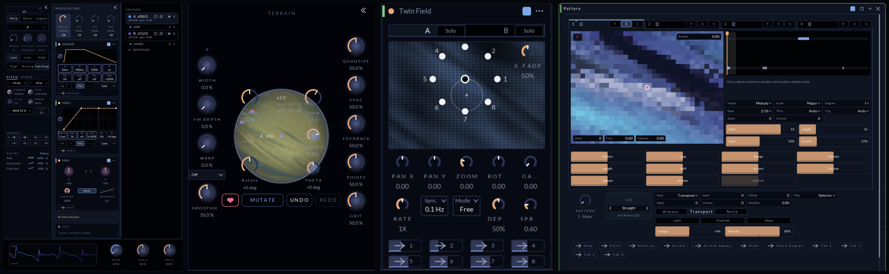

Feathers is a polyphonic synthesizer and effects rack, built as a CLAP plugin (VST3 and a standalone come from the same code). Its oscillators read their character from a **terrain**, a field you move through instead of a list of waveforms. Around that engine sit a **modulation system** where modulators are devices like any other, and an **effects lane** of devices that can hold lanes, chains and racks of their own.

**Linux is a first-class platform.** Feathers is developed and played on Linux every day (in Bitwig), and every
pre-release build ships for Linux x86-64 alongside the universal macOS build and Windows x86-64. On Windows the
synth plays but has no editor window yet: the window embed for Windows is still to be written.

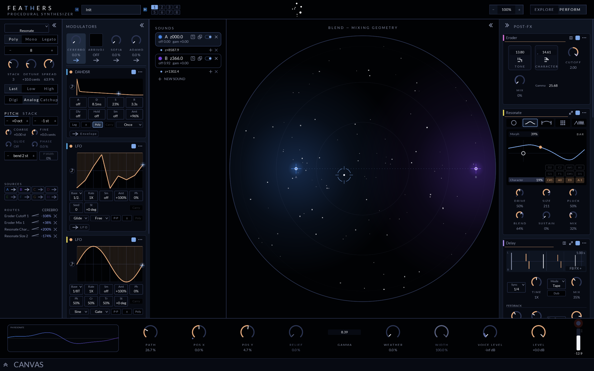
*The full editor with a factory preset (Wood Elves). From left to right: the Engine rail (voice, pitch and stack, with the route list for the focused source at the bottom), the modulator lane (DAHDSR, two LFOs), the sounds and their blend geometry, and the post-fx lane (Eroder, Resonate, Delay). The route list shows four routes from one modulator into two devices, each with its amount and transfer curve. The preset name box reads "Init" because the capture host loads the patch state directly, not through the preset browser.*

## Sound engines

Each sound is a position on a terrain. The Explore surface shows the terrain under the puck, and lets you mutate it, like a result, and undo or redo. Engines include V5, Additive, Pluck, Drum, Resonate and Basic Shapes, plus the original Morph and Stair.

| | |
|---|---|
| 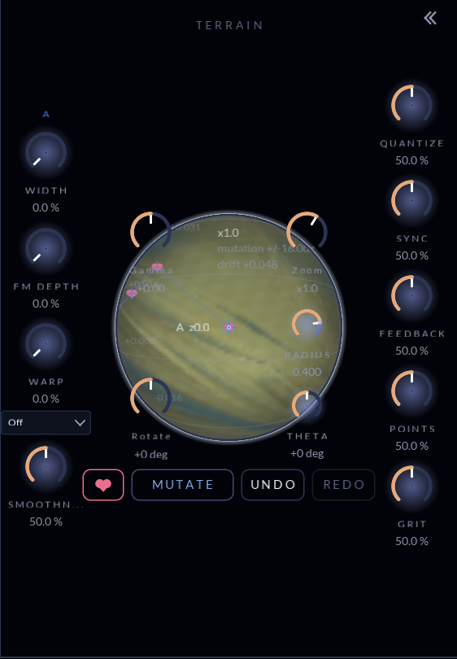 | 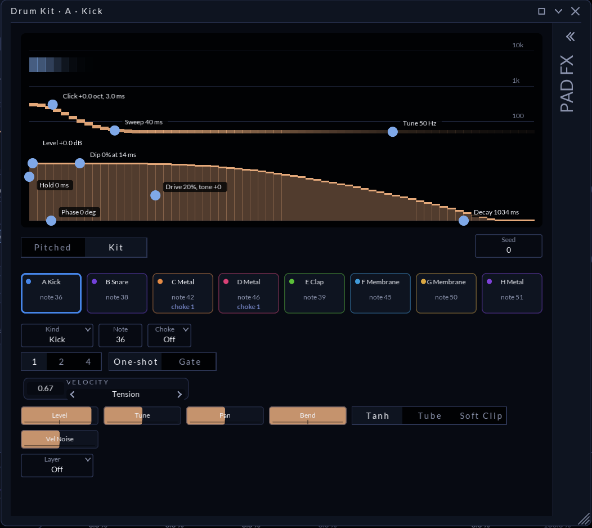 |
| *Explore: the terrain under sound A, with Rotate, Theta and Radius on its rim, Mutate / Undo / Redo and the like heart. A macro route into Radius is drawn along the knob's face.* | *The Drum engine's kit window: eight pads, each with its own kind, note and choke group, and the hit picture with draggable handles for click, sweep, tune, dip, drive and decay. The PAD FX rail is folded at the right.* |

## Modulation as a first-class system

Modulators live in a lane of their own and are added, reordered and removed like effects. The ones shown here: DAHDSR, LFO, MSEG, Math, Twin Field and Pattern. Others include Step Seq, Sample & Hold, Random Trigger, Follower, Macros and Note Expressions. Every output is a source you can route to any modulatable parameter, whether on the engine or on a device.

- **Routes have transfer curves.** Each route carries its own curve (linear, exponential, logarithmic, φ, and rectifiers for bipolar sources), drawn as a glyph in the route list.
- **Live readouts.** A modulated control shows its ring and its as-modulated value. When a source is armed, every destination it can reach glows.
- **Determinism and persistence.** Values that can be derived (from the seed and the song position) are derived, so a reload reproduces them. Values that cannot be derived (held samples, frozen buffers, random draws, mutate results) are saved with the patch.

| | |
|---|---|
| 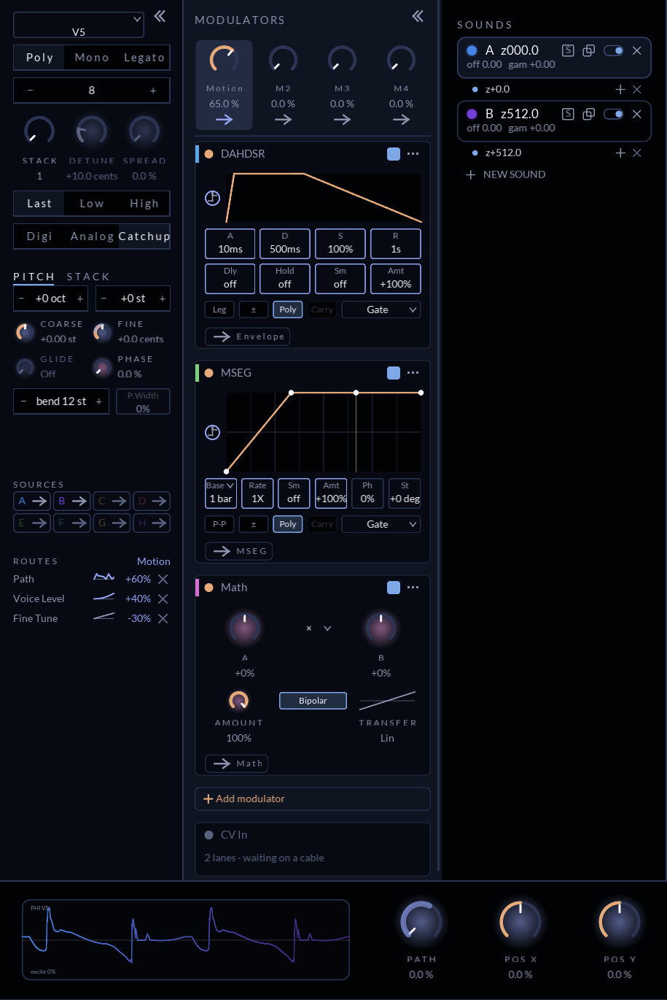 | 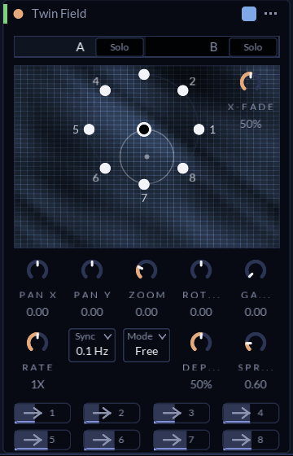 |
| *A macro ("Motion") armed and routed into three engine parameters through three curves (φ, exponential, linear). The route list shows each curve's glyph, and the destination knobs glow. MSEG and Math sit in the modulator lane.* | *Twin Field: two terrains read at eight points around an orbit, giving a 2×4 block of live outputs, each routable.* |

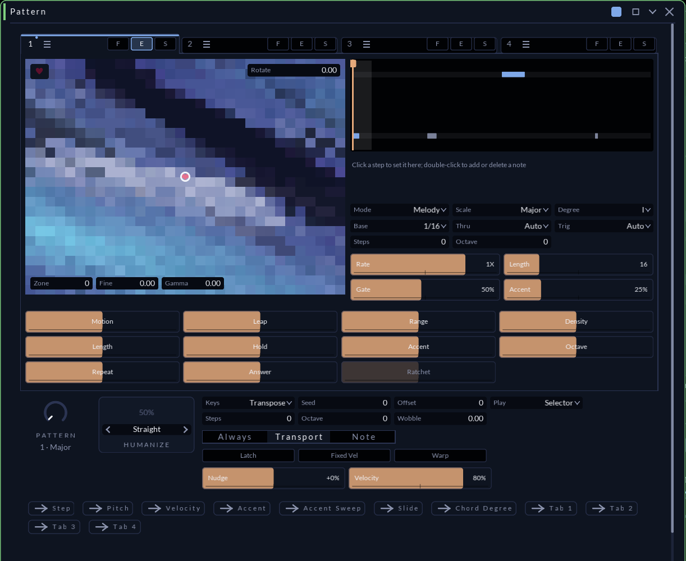
*Pattern: a generative sequencer that reads its melody from a terrain. It has four tabs with fill/edit/solo, a step lane, scale and degree, humanize, and routable outputs (step, pitch, velocity, accent, chord degree, per-tab gates).*

## Effects depth

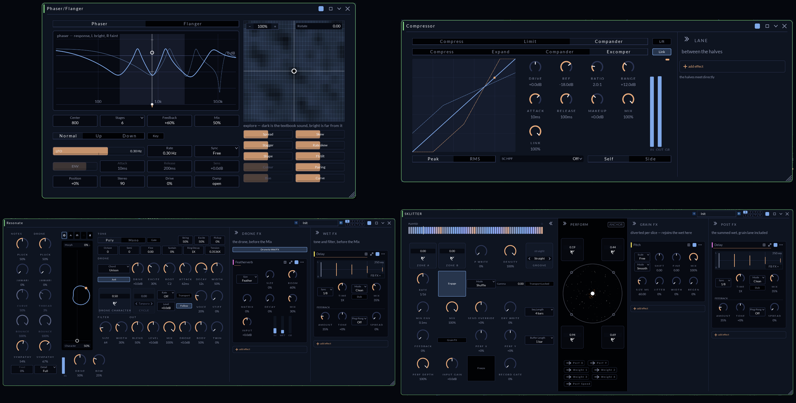

Effects are devices in a lane. Each has a compact card and a larger window that offers every control on the card and usually more. Several devices hold lanes of their own: the Delay's feedback path, the Compressor's lane between its two halves, Resonate's drone and wet lanes, SKLITTER's grain and post lanes. **Chain** and **Rack** devices nest whole chains, in series or in parallel.

A Rack's **mode** decides what each of its chains hears and how they come back together:

- **Parallel**: every chain hears the input, and their outputs sum.
- **Select** and **Blend**: a Position control picks one chain, or crossfades between neighbours. Modulate it and the rack becomes a morphing switcher.
- **Mid/Side**: the first chain processes the mid signal and the second the side, so you can widen, saturate or delay only the sides.
- **Left/Right**: the same, per channel.
- **Bands**: a multiband splitter into 2, 3 or 5 bands, with adjustable crossovers and slope (Linkwitz-Riley), one chain per band. Where the band filtering sits is a choice:
  - **Before**: each chain is handed only its band, the classic multiband.
  - **After**: every chain hears the full signal and its output is band-limited afterwards, so the harmonics a chain creates stay inside its band.
  - **Both**: filtered on the way in and on the way out.

  With **Key Track**, the played note places the crossovers.

Racks nest inside racks and chains to any depth.

| | |
|---|---|
| 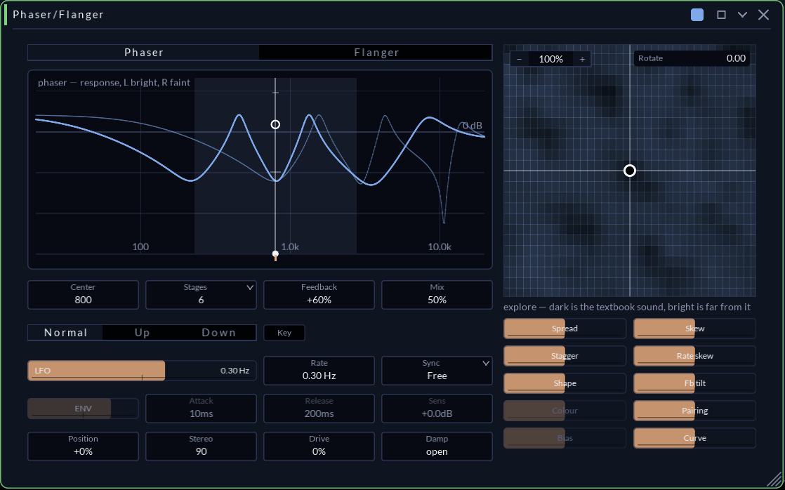 | 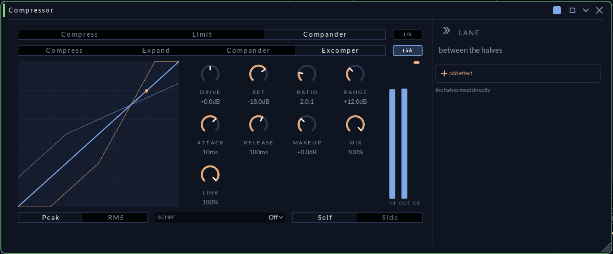 |
| *Phaser/Flanger: the live response curve, and an explore field whose brightness shows how far a setting is from the textbook sound.* | *Compressor in Compander mode with the Excomper topology: the transfer curve, an IN/OUT/GR meter, and a lane for devices between the two halves.* |
| 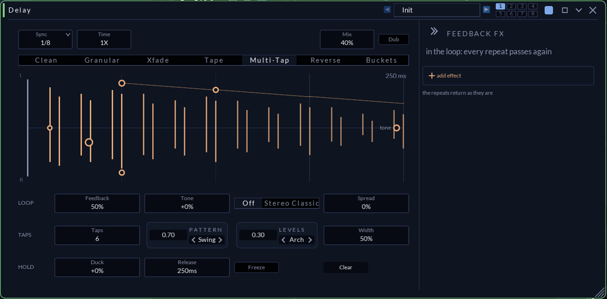 | 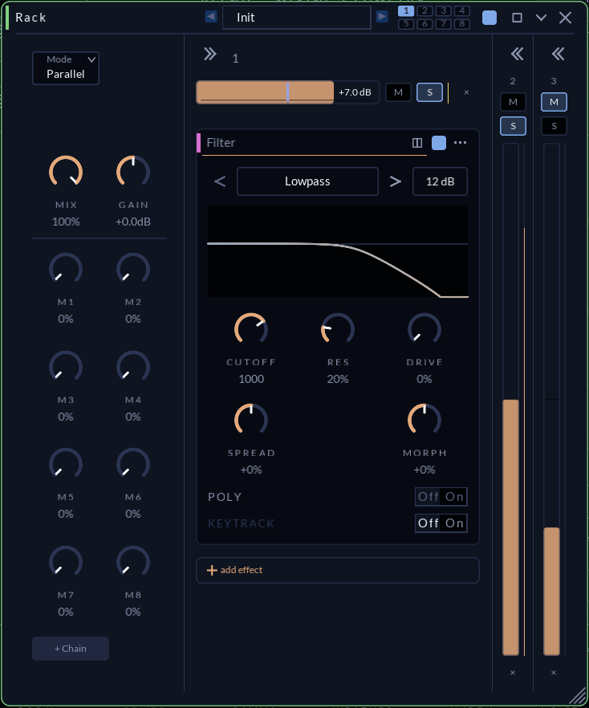 |
| *Delay: seven modes (Clean, Granular, Xfade, Tape, Multi-Tap, Reverse, Buckets). This is Multi-Tap, with pattern and level shapes as zone controls, and the feedback-fx lane where every repeat passes through again.* | *Rack: parallel chains, each with a level, mute and solo and its own devices, plus a column of eight macros.* |

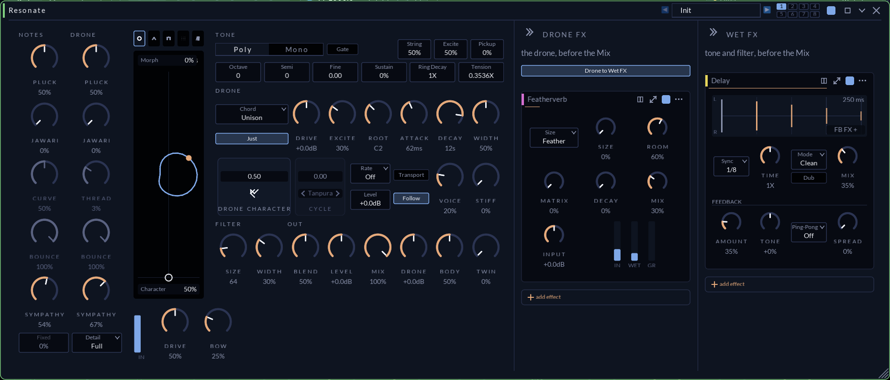
*Resonate: a string and body resonator with separate Notes and Drone voices. Its drone lane (here holding Featherverb) and its wet lane (here a Delay) are open beside it.*

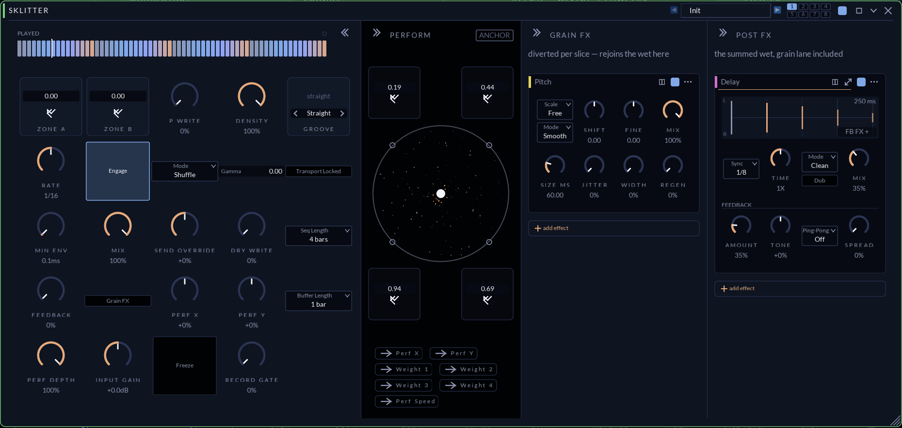
*SKLITTER: a performance slicer and granulator. The perform circle blends four stored zone settings, and the grain-fx and post-fx lanes hold Pitch and Delay.*

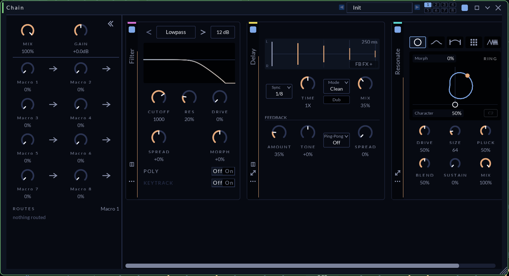
*A Chain device holding a Filter, a Delay and a Resonate in series, with its own macro column and route list.*

### Every device window

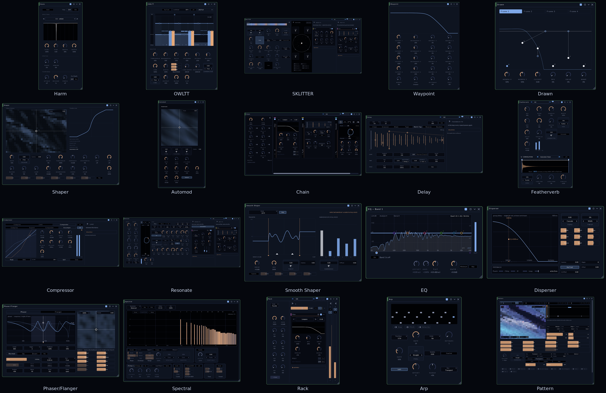
*The expanded window of every device that has one (20 of the 40 devices; the rest are card-only). Each window is also in [`docs/readme/windows/`](docs/readme/windows/).*

### Every device card

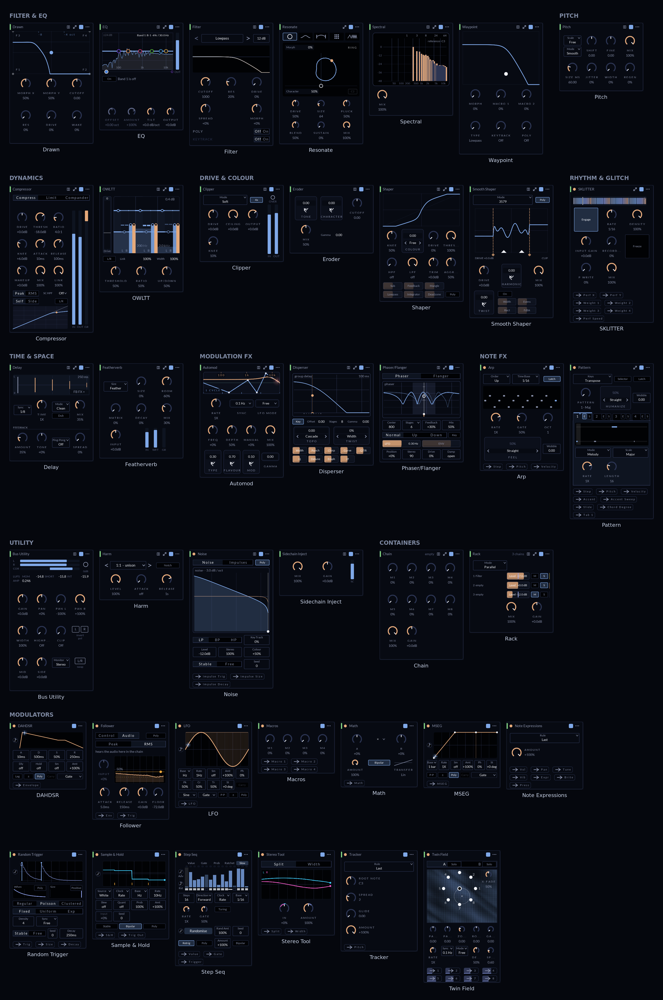
*The card of all 40 devices, the compact face each one shows in a lane, grouped by category; each card is also in [`docs/readme/cards/`](docs/readme/cards/).*

<details>
<summary><b>All 40 devices and 8 engines, by category</b></summary>

<!-- device-list: generated by `scripts/readme-device-list.sh build` (a build with -DFEATHERS_BUILD_TOOLS=ON) from the
     device registry, with descriptions from docs/readme/device-descriptions.tsv. Regenerate it; don't edit by hand. -->

#### Engines

- **Morph**: The original PhiMorph oscillator.
- **Stair**: The original PhiStair oscillator.
- **V5**: The default engine.
- **Resonate**: A resonator engine: a string, bar, tube or membrane model.
- **Basic Shapes**: Classic oscillator shapes.
- **Additive**: Additive synthesis, with a spectrum panel of partial operators and a vocoder.
- **Pluck**: Plucked-string engine.
- **Drum**: Eight-pad drum kit, with a hit picture per pad and a PAD FX rail.

#### Filter & EQ

- **Drawn** (window): A filter whose response is drawn: four frames blended on an XY pad.
- **EQ** (window): Parametric EQ for surgical and mastering work, with an analyser.
- **Filter**: Multimode filter: lowpass, bandpass, highpass and more, with drive, spread and morph.
- **Resonate** (window): Scanned-string resonator: bowed and plucked notes plus a drone, with effects lanes for each.
- **Spectral** (window): Spectral effect: the Additive engine's partial operators applied to any audio.
- **Waypoint** (window): Four filter states on a plane, and one Morph that walks between them.

#### Dynamics

- **Compressor** (window): Compressor, limiter and compander, with a lane between the compander's halves.
- **OWLTT** (window): Three-band upward and downward compressor, with Character and Vibe zones.

#### Drive & Colour

- **Clipper**: Clipper with five characters and 4x oversampling.
- **Eroder**: A very short comb whose delay is shaken by filtered noise, then soft-clipped and folded.
- **Shaper** (window): Table waveshaper whose curve is a place in a φ-field rather than a preset.
- **Smooth Shaper** (window): Eight waveshapers behind one knob, and a Twist that sweeps four modifiers at once.

#### Time & Space

- **Delay** (window): Delay with Clean, Granular, Xfade, Tape, Multi-Tap, Reverse and Buckets modes, and an effects lane in its feedback loop.
- **Featherverb** (window): An algorithmic reverb, extended with a convolution section.

#### Pitch

- **Pitch**: Pitch shifter, with an option to lock to a scale.

#### Rhythm & Glitch

- **SKLITTER** (window): Stutterer: eight slicing modes over one ring buffer, a perform circle, grain and post lanes.

#### Modulation FX

- **Automod** (window): The Automodulator: an auto-wah whose filter, comb and envelope response are read from one position in the φ-field.
- **Disperser** (window): A dispersion (allpass group-delay) effect.
- **Phaser/Flanger** (window): Phaser and flanger, with a response view and an explore field.

#### Utility

- **Bus Utility**: Gain, pan, dual pan, width and polarity.
- **Harm** (window): Strips the fundamental with a note-tracking notch and puts a clean sine sub-harmonic back.
- **Noise**: Adds noise or pseudorandom impulses to whatever passes, through its own filter.
- **Sidechain Inject**: Brings the plugin's sidechain input into the chain at this point.

#### Modulators

- **DAHDSR**: Delay, attack, hold, decay, sustain, release envelope.
- **Follower**: Envelope follower, and a threshold that turns any signal into trigger pulses.
- **LFO**: Low-frequency oscillator with shapes, sync, phase and its own preview.
- **Macros**: Four macro knobs as a modulator device.
- **Math**: Combines two modulation inputs into one output, through a transfer curve.
- **MSEG**: Multi-segment envelope: a shape made of segments you draw.
- **Note Expressions**: Seven per-note controllers (volume, pan, tune, vibrato, expression, brightness and more) as routable outputs.
- **Random Trigger**: Pseudorandom events as modulation.
- **Sample & Hold**: Sample & Hold, with a built-in noise source and a trigger threshold.
- **Step Seq**: Step sequencer: up to 32 steps of value, gate, probability, ratchet and slew, with randomisation.
- **Stereo Tool**: Left/right modulation sources (split, width) for stereo routes.
- **Tracker**: Pitch tracker: the held note's pitch as a modulation source, with a rule for which note of a chord it follows.
- **Twin Field**: Eight modulation outputs read off the φ terrain in two crossfaded layers.

#### Note FX

- **Arp** (window): Classic arpeggiator: makes notes from the held chord.
- **Pattern** (window): A terrain arpeggiator with four patterns, fills and routable outputs.

#### Containers

- **Chain** (window): Devices in series inside one slot, with its own macros and routes.
- **Rack** (window): Chains side by side, combined by mode (Parallel, Select/Blend, Mid/Side, Left/Right, Bands), each with level, mute and solo, plus eight macros.

<!-- /device-list -->

</details>

## An open standard for devices and modulation

The cards, dockable devices and unified modulation in these screenshots are meant to become an **open standard**. The test we hold it to: a device written by someone who has never read our code should drop into a chain or rack and look and behave native.

The standard has four parts, all in the tree today:

1. **A host-neutral device vocabulary** (`src/device/device.h`, `src/device/registry.h`). A device declares its controls, outputs and traits: names, ranges, units and choices, with nothing naming CLAP or Feathers. It then supplies static ops tables for what it does (audio, modulation, notes). A missing table means a missing capability.
2. **One modulation interface** (`src/device/modulatable.h`). Any widget that implements it becomes a modulation destination, with arming, glow, amount dragging and routing that behave exactly like the stock knob. It is an interface, not a widget library.
3. **The routing model** (`src/backplane/`). Routes, sources, and the small set of operations a card needs from whatever hosts its device.
4. **The card floor.** Stock cards, knobs and theme roles, which a device can use or ignore.

Only the first tier is compulsory. A device owns its UI: it can draw a bespoke card and expanded window, or fall back to the generic card, which it gets for free. Stock widgets and theme conformity are opt-in. Every device here, from the Delay to SKLITTER and the Pattern sequencer, is built on this contract, and two hosts already run it: Feathers itself and the separate Feathers Chain plugin.

What is still open, and where we want help: extracting the contract into its own package, the licence that package ships under, and proving the "drop in and look native" test at link time with devices written outside this repo. Plugin and tool authors who would build on it are the people best placed to shape it.

## Hosting: what is built, and what is planned

**Built today: exposing Feathers to the DAW ("host slots").** Feathers' core parameters are host parameters. Controls inside devices reach the DAW through a pool of pre-declared host parameters ("slots"), which works in both CLAP and VST3. Right-click a control and choose "Expose to host" to pin it to a slot. Turning the knob records automation, and DAW automation and modulation move the knob. Slots map devices at any depth, including racks nested inside racks, and they are saved with the project. Still being built: devices proposing default mappings for their headline controls, presets carrying their pinned slots, and CLAP remote-controls pages.

**Planned, not built: hosting third-party plugins inside Feathers' chains and racks.** The design is a generic wrapper that lifts a third-party CLAP plugin in as a device:

- its parameters are read from the plugin and become device controls;
- modulation routes reach it as CLAP's native parameter-modulation events, which use the same base-plus-offset model as ours, so the plugin never needs to know a modulator exists;
- glow, arming and route editing come from our side.

This work is deferred, not dropped, and it is shaping the architecture now. Device descriptors must tolerate parameters known only at run time, and the latency design treats a hosted plugin's changing latency and its event stream as part of the graph's node contract rather than something special. The first version runs the plugin in-process, behind the generic card. Not yet in scope: showing the plugin's own GUI inside ours, and out-of-process sandboxing. The design so far covers CLAP plugins.

**Planned: native devices from third parties, open or closed.** Beyond wrapping any CLAP plugin, the goal is for other people's devices to be first-class: their own cards and windows, docking, and the full modulation system (arming, glow, routes, transfer curves), exactly like the devices in these screenshots. To make that possible, the device vocabulary and modulation interface are to be published as a separate **device SDK under a permissive licence**. A device built on the SDK can be **open source or closed source**; Feathers itself stays GPL-3.0-or-later. So the roadmap for hosting is two roads:

1. **Any CLAP plugin**, open or closed, through the generic wrapper above.
2. **Devices built on the Feathers device SDK**, open or closed, hosted natively with Feathers' cards and modulation.

If you build plugins and would like your devices to run natively inside Feathers, we would like to hear from you: the SDK's shape is still open.

## What we're looking for

The core of Feathers is, and will remain, open source under the GNU General Public License, version 3 or later (see [`LICENSE`](LICENSE) and the notices in [`THIRD-PARTY-NOTICES.md`](THIRD-PARTY-NOTICES.md)). The open device standard means anyone, us included, can build devices on top of that core. Feathers is in active development, and we would like to hear from:

- **Collaborators**: DSP, UI or platform people who want to work on a deep, test-heavy C++ codebase (CLAP, visage).
- **Design partners**: sound designers, producers and performers willing to use pre-release builds, give us patches and feedback, and help decide what the instrument should become.

## Trying it

Pre-release builds come from GitHub Actions. Open the [`build` workflow](https://github.com/owlet-labs/feathers/actions/workflows/build.yml), choose the latest successful run, and download the artifact for your platform from the bottom of its page:

| Platform | Artifact | Contains |
|---|---|---|
| macOS (Apple silicon and Intel) | `feathers-macos-universal2-installer` | an installer zip: the synth and the Chain, as CLAP and VST3, plus `install.command` |
| Linux x86-64 | `feathers-linux-x86_64` | the synth and the Chain, as CLAP and VST3 |
| Windows x86-64 | `feathers-windows-x86_64` | the synth and the Chain, as CLAP and VST3, plus the synth's standalone `.exe`; **no editor window yet** |

Downloading artifacts needs a signed-in GitHub account, and a run keeps its artifacts for **7 days**, so take them from a recent run. These are pre-release builds: expect rough edges, and please [report what you find](https://github.com/owlet-labs/feathers/issues).

### Installing on macOS

GitHub wraps every artifact in a zip, so there are two: unzip the download, then unzip the `Feathers-macos-universal2-….zip` inside it.

The builds are signed ad hoc, **not notarised**, so macOS quarantines them when they are downloaded, and a DAW will refuse to load a quarantined plugin. The included installer clears the quarantine and copies the plugins into place:

1. In the unzipped folder, **right-click `install.command` and choose Open**, then click Open again. (A plain double-click is blocked the first time, because the script is downloaded and unsigned; right-click > Open is macOS's one-time exception.)
2. It copies the CLAP plugins into `~/Library/Audio/Plug-Ins/CLAP/` and the VST3 plugins into `~/Library/Audio/Plug-Ins/VST3/`, clears the quarantine on each, and prints what it installed.
3. Restart your DAW, or have it rescan its plugins.

To do it by hand instead, copy the bundles into those folders and clear the quarantine yourself:

```sh
xattr -dr com.apple.quarantine ~/Library/Audio/Plug-Ins/CLAP/feathers*.clap ~/Library/Audio/Plug-Ins/VST3/feathers*.vst3
```

If Terminal says "permission denied" for `install.command`, the executable bit was lost in transit: run `chmod +x install.command` and try again.

### Installing on Linux

Unzip the artifact and copy the plugins into your user plugin folders, then rescan in your DAW:

```sh
mkdir -p ~/.clap ~/.vst3
cp -r feathers.clap feathers-chain.clap ~/.clap/
cp -r feathers.vst3 feathers-chain.vst3 ~/.vst3/
```

Feathers is built and played daily in Bitwig on Linux. If your DAW runs as a Flatpak and does not see the plugin, give it access to those folders (for example `flatpak override --user --filesystem=~/.clap --filesystem=~/.vst3 <app id>`).

### Installing on Windows

**There is no editor window on Windows yet.** The plugins load and play (parameters, automation, presets saved by the host, MIDI), but the host shows no Feathers window: the window embed for Windows is still to be written. Everything else is the same build as Linux and macOS, and passes the same test suite.

Unzip the artifact. Inside are:

| Path | What it is |
|---|---|
| `CLAP\feathers.clap`, `CLAP\feathers-chain.clap` | the synth and the Chain, as CLAP plugins (one file each) |
| `VST3\feathers.vst3`, `VST3\feathers-chain.vst3` | the same two as VST3 plugins (one file each) |
| `Standalone-feathers_standalone\feathers-standalone.exe` | the synth as a standalone app, for MIDI and audio without a DAW (no window yet, as above) |
| `THIRD-PARTY-NOTICES.md` | the licences of what the plugins contain; keep it with them |

Copy the two `.clap` files into `C:\Program Files\Common Files\CLAP\` and the two `.vst3` files into `C:\Program Files\Common Files\VST3\` (both need administrator rights), then rescan in your DAW. **No Visual C++ runtime is needed**: the C++ runtime is linked into the plugins, which import only DLLs that ship with Windows 10 and 11.

The builds are not code-signed, so Windows marks downloaded files as coming from the internet. If your DAW will not load the plugin, unblock it: right-click the file, choose **Properties**, tick **Unblock** and click OK, or in PowerShell:

```powershell
Get-ChildItem "C:\Program Files\Common Files\CLAP\feathers*.clap", "C:\Program Files\Common Files\VST3\feathers*.vst3" | Unblock-File
```

SmartScreen may also warn about the zip or the standalone `.exe`: choose **More info**, then **Run anyway** or **Keep**.

## Getting in touch

[Open an issue](https://github.com/owlet-labs/feathers/issues) on owlet-labs/feathers and tell us what you would like to work on, build or try.

---

## Getting the source

```
git clone <this repo>
cd feathers
git submodule update --init --recursive
```

Every submodule under `libs/` is public and fetches anonymously.

## Building

Requires CMake ≥ 3.24, Ninja, and a C++20 compiler (GCC 13 or later, or Clang).

```
cmake -B build -G Ninja -DCMAKE_BUILD_TYPE=Release
cmake --build build
```

The first configure of a fresh build directory **needs network**: clap-wrapper fetches the VST3 SDK
(~47 MB) for the VST3 target and RtAudio/RtMidi for the standalone, into `build/cpm/`, and visage
fetches FreeType (and, on Linux, the Vulkan headers if none are installed) plus the glslang and
SPIRV-Cross libraries its shader compiler uses, into `build/_deps/`. Later configures reuse what is
already there. The CLAP SDK is a submodule and is not downloaded.

On Linux the editor needs fontconfig and X11/XCB headers. `.github/workflows/build.yml` lists the
packages CI installs on Ubuntu (`libfontconfig-dev`, `libx11-dev`, `libxrandr-dev`,
`libxcb-present-dev` and others). The standalone also needs ALSA headers (`libasound2-dev`). Install
`libjack-jackd2-dev` and/or `libpulse-dev` **before** the first configure if you want RtAudio to
offer those backends — its API detection is cached, so adding them later means a fresh build
directory.

`scripts/env.sh` points at one development machine's local toolchain and is for that machine only;
CI uses each platform's own toolchain and never sources it.

## Testing

```
ctest --test-dir build --output-on-failure
```

Two suites, `vox-voice` and `flagship`, carry the ctest label `platform-pinned`: they assert bake
identity to the bit, and arm64 produces different bits for the same bake. Suites that need a display
carry `headless-incompatible`. Off Linux x86-64, or without a display, run:

```
ctest --test-dir build --output-on-failure --label-exclude "platform-pinned|headless-incompatible"
```

## What the build produces

In `build/`:

| | |
|---|---|
| `feathers.clap` | the plugin; native format |
| `feathers-chain.clap` | Feathers Chain: a chain of Feathers devices, with a modulation backplane, as its own plugin |
| `feathers.vst3` | same plugin through clap-wrapper |
| `feathers-standalone` | self-hosting executable, for auditioning without a DAW |

To install the CLAP for a host to find, copy it where the host looks — `~/.clap` on Linux,
`~/Library/Audio/Plug-Ins/CLAP` on macOS — or point `CLAP_PATH` at `build/`. The VST3 goes in
`~/.vst3` or `~/Library/Audio/Plug-Ins/VST3` the same way.

The standalone takes no arguments. It opens the default audio device, binds every MIDI input port
that exists **when it starts** (so start your controller or virtual keyboard first), and runs until
interrupted.

CI artifacts are built on request for Linux x86-64 and macOS universal2 (arm64 + x86_64). The macOS
bundles are **ad-hoc signed, not notarised** — the installer zip's `install.command` clears the
quarantine flag, or do it by hand (`xattr -dr com.apple.quarantine <path>`) until there is a
Developer ID to sign with.

## Licence

Feathers is licensed under the GNU General Public License, version 3 or later
(SPDX: `GPL-3.0-or-later`). See [`LICENSE`](LICENSE) for the full text.

Everything under `src/`, `tests/` and `tools/` is © Owlet Records, GPL-3.0-or-later, with one
exception: `src/fx/filter/cytomic_svf.h` is MIT by its author's carve-out (see `THIRD-PARTY-NOTICES.md`).

No GPL third-party library is linked.

The vendored dependencies keep their own licences: the CLAP SDK, clap-helpers, clap-wrapper,
sst-voicemanager, sst-cpputils, simde, visage, dr_libs and doctest are MIT, MIT-like or public
domain, and pffft is BSD-style. The VST3 SDK (MIT), RtAudio and RtMidi (MIT-style) and FreeType
(used under the FreeType License) are fetched at configure time rather than vendored.
`THIRD-PARTY-NOTICES.md` lists everything that ships, with the licence texts.

To contribute, see [`CONTRIBUTING.md`](CONTRIBUTING.md).
